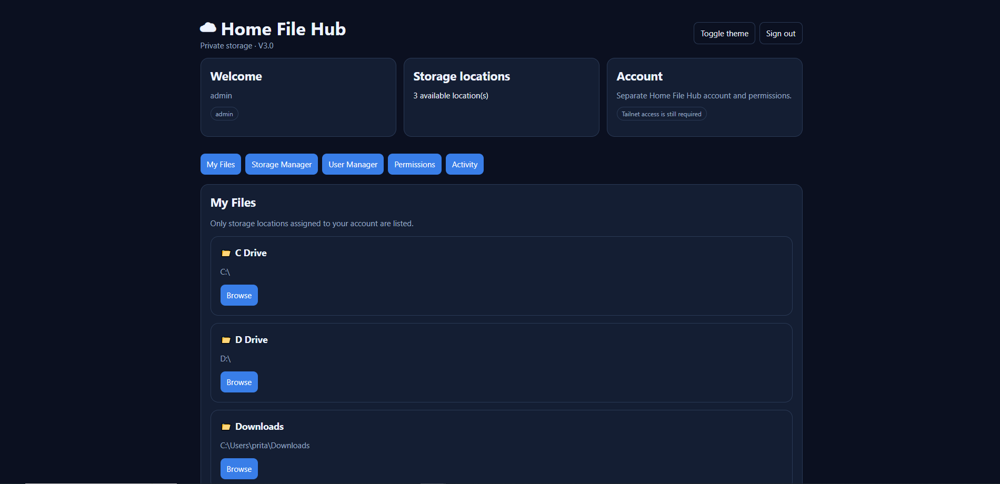
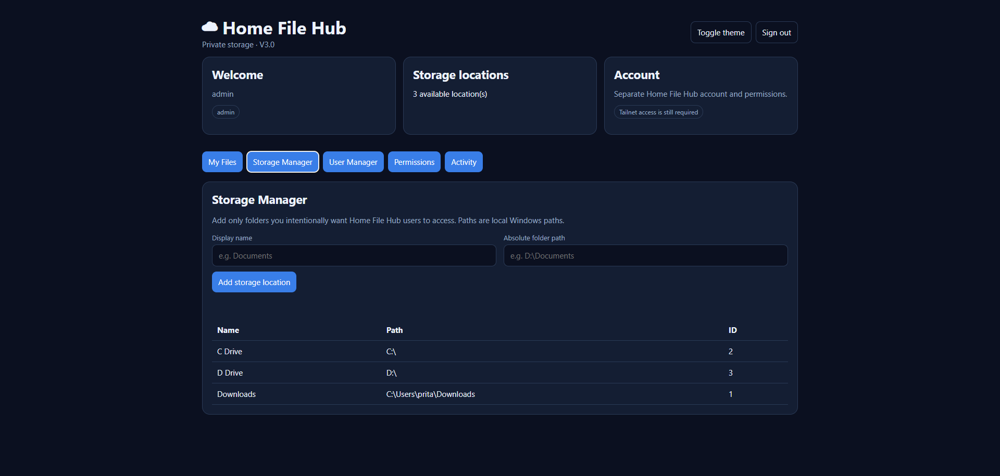
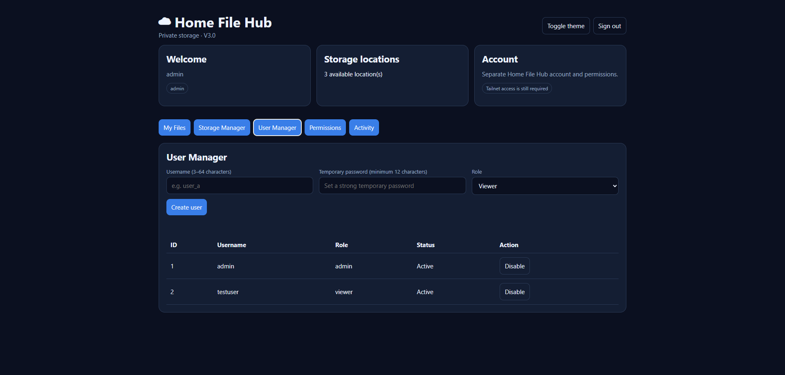
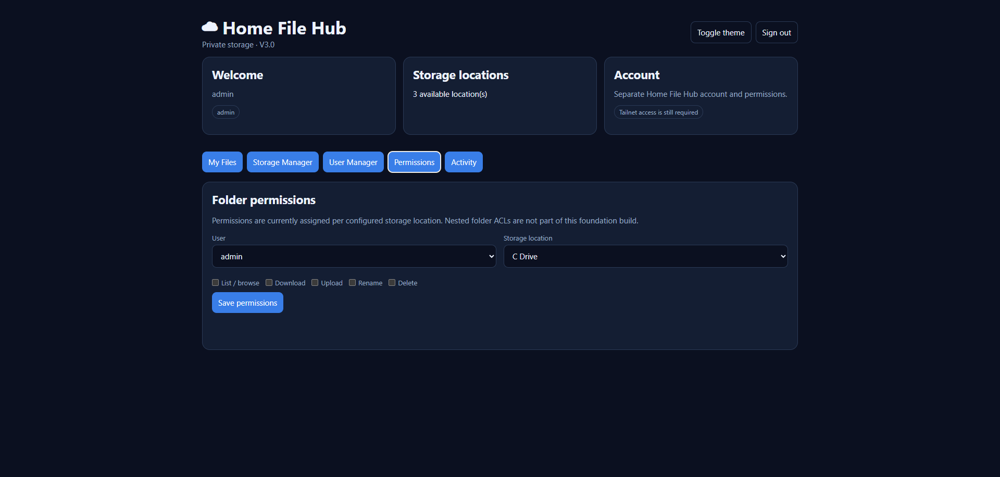
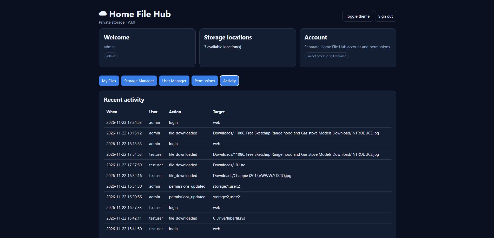

# Home File Hub V3

A self-hosted, multi-user file access hub for Windows. Home File Hub provides a browser-based interface for browsing configured folders, downloading files, managing accounts, and assigning per-storage permissions. It is designed to be accessed remotely over a private Tailscale network using Tailscale Serve.

> **Project status:** Development / foundation build. This project has been tested by its author for remote sign-in, browsing and file download from an Android phone over mobile data through Tailscale. It has not undergone an independent security audit.

## Features

- Browser-based sign-in and responsive file browser
- Separate Home File Hub user accounts
- Administrator, editor, viewer and custom role labels
- Argon2 password hashing
- Server-side sessions with hashed session tokens
- HttpOnly, Secure and SameSite=Strict session cookie
- CSRF token checks on state-changing authenticated endpoints
- Administrator-managed storage locations
- Per-user, per-storage permissions for listing, downloading, uploading, renaming and deleting
- Directory traversal protection when resolving requested paths
- File listing and download
- File upload API with a 2 GB application-level upload limit
- Activity logging for selected account and file actions
- SQLite database
- Dark/light theme toggle
- FastAPI interactive API documentation at `/docs`
- Private remote access through Tailscale Serve

## Application Screenshots

### Dashboard


### Storage Manager


### User Manager


### Permission Manager


### Activity Log


### Current implementation notes

- The browser interface currently provides storage browsing and file downloading, plus administrator interfaces for user management, storage management, permissions and activity.
- A file-upload API endpoint exists, but the current browser interface does not provide an upload form.
- Rename and delete permission fields are stored, but rename/delete file endpoints are not implemented in this build.
- Permissions are assigned per configured storage location, not per nested folder.
- Non-admin users are denied access to a storage location until an administrator explicitly assigns permissions. The role label alone does not grant storage access.
- This is a foundation build, not a production-audited file server.

## Architecture

```text
Browser (PC / Android)
        |
        | HTTPS over private tailnet
        v
Tailscale Serve
        |
        | reverse proxy to loopback
        v
FastAPI + Uvicorn
        |
        +---- Authentication / session / CSRF checks
        |
        +---- SQLite database
        |       users
        |       sessions
        |       storage_locations
        |       folder_permissions
        |       activity_logs
        |
        +---- Configured Windows storage folders
                browse / list / download
                upload API
```

### Main source files

| Path | Purpose |
|---|---|
| `run_server.py` | Command-line entry point, database initialization and first-admin setup |
| `app/main.py` | FastAPI application, routes, authentication dependencies, permissions and file operations |
| `app/db.py` | SQLite connection handling and database schema |
| `app/security.py` | Password hashing and session-token helpers |
| `app/static/index.html` | Browser interface, styles and client-side JavaScript |
| `requirements.txt` | Python dependencies |
| `.gitignore` | Files and local data excluded from Git |

## Requirements

- Windows 10 or Windows 11
- Python 3.10 or newer
- pip
- Tailscale for private remote access (optional for local-only use)

## Installation

Open PowerShell and move to the folder where you want the project:

```powershell
git clone https://github.com/YOUR-USERNAME/Home-File-Hub-V3.git
cd Home-File-Hub-V3
```

Create and activate a virtual environment:

```powershell
py -m venv .venv
.\.venv\Scripts\Activate.ps1
python -m pip install --upgrade pip
pip install -r requirements.txt
```

If PowerShell blocks activation, you can run the virtual-environment Python directly instead:

```powershell
.\.venv\Scripts\python.exe -m pip install -r requirements.txt
```

## First-time setup

Create the first administrator account:

```powershell
python run_server.py --init-admin
```

- The initial username is `admin`.
- The administrator password is entered interactively.
- Use a unique password of at least 12 characters.
- Do not commit the database or share the administrator password.

## Run locally

The application defaults to `127.0.0.1:8000`:

```powershell
python run_server.py
```

Open:

```text
http://127.0.0.1:8000
```

For a port-8001 setup:

```powershell
python run_server.py --port 8001
```

The server binds to loopback by default. Keep it that way when using Tailscale Serve.

## Private remote access with Tailscale Serve

1. Install Tailscale on the Windows host and the phone or other client.
2. Sign in to the same tailnet on both devices.
3. Start Home File Hub on the Windows host. For example:

   ```powershell
   python run_server.py --port 8001
   ```

4. In a separate PowerShell window, configure Tailscale Serve to proxy HTTPS traffic to the local application:

   ```powershell
   tailscale serve --bg http://127.0.0.1:8001
   ```

5. Check the configured Serve URL:

   ```powershell
   tailscale serve status
   ```

6. Open the HTTPS tailnet URL shown by Tailscale on the Android device or another tailnet-connected client.

**Do not use Tailscale Funnel, router port forwarding, or public port exposure for this private file hub.** The application is intended to remain accessible only through the private tailnet. Do not change the server bind address to `0.0.0.0` unless you understand and have deliberately designed the network exposure.

To stop the application, press `Ctrl+C` in the terminal running Home File Hub. To stop the Serve proxy, use the Tailscale Serve command shown by `tailscale serve --help` for your installed version.

## First administrator tasks

After signing in as the administrator:

1. Open **Storage Manager** and add only the folders you intend to share.
2. Open **User Manager** and create separate accounts for other people or devices.
3. Open **Permissions** and assign access for each user and storage location.
4. Use **Activity** to review the activity events recorded by the application.

Example storage location:

```text
Name: Downloads
Path: C:\Users\YOUR-WINDOWS-USERNAME\Downloads
```

Avoid adding the entire system drive. A configured storage location is a root boundary for that storage entry; only add directories you intend to make available to authorized accounts.

## Roles and permissions

The application recognizes these role labels:

- `admin`
- `editor`
- `viewer`
- `custom`

Administrators have full access to configured storage locations and administrator functions. For non-admin accounts, actual file access is controlled by the per-user, per-storage permission record. If no permission record exists, access is denied by default.

The permission fields are:

| Permission | Current status |
|---|---|
| List / browse | Implemented |
| Download | Implemented |
| Upload | API implemented; browser upload UI not yet included |
| Rename | Permission field stored; file operation not implemented |
| Delete | Permission field stored; file operation not implemented |

## API overview

FastAPI's interactive documentation is available at:

```text
/docs
```

Main endpoints in this build:

| Method | Endpoint | Purpose |
|---|---|---|
| `GET` | `/health` | Health check |
| `POST` | `/api/login` | Sign in |
| `GET` | `/api/me` | Current account |
| `POST` | `/api/logout` | Sign out |
| `GET` | `/api/users` | List users (admin) |
| `POST` | `/api/users` | Create user (admin) |
| `PATCH` | `/api/users/{user_id}/active` | Enable or disable a user (admin) |
| `GET` | `/api/storage` | List storage available to the account |
| `POST` | `/api/storage` | Add a storage location (admin) |
| `POST` | `/api/storage/{storage_id}/permissions` | Set per-storage permissions (admin) |
| `GET` | `/api/files` | List a directory |
| `POST` | `/api/files/upload` | Upload a file (API) |
| `GET` | `/api/files/download` | Download a file |
| `GET` | `/api/activity` | View recent activity (admin) |

State-changing authenticated endpoints require the CSRF token returned during authentication.

## Database and local data

At runtime, the application creates:

```text
data/
└── home_file_hub.db
```

SQLite may also create `-wal` and `-shm` companion files while the database is active. These files contain local application state and must not be committed to Git.

Back up the database while the application is stopped, or use a SQLite-consistent backup procedure. Do not publish a real database: it can contain account records, password hashes, session-related data, configured Windows paths and activity history.

## Security considerations

- Use Tailscale Serve for private HTTPS access.
- Do not expose the application directly to the public internet.
- Do not use Tailscale Funnel or public port forwarding.
- Keep storage roots limited to folders you intentionally share.
- Use unique, strong passwords.
- Keep the database, virtual environment, logs, backups and credentials out of Git.
- Review changes before deploying them against important personal files.
- The project has not been independently penetration-tested or security-audited.

See [`SECURITY.md`](SECURITY.md) for additional publication and deployment cautions.

## Development status / roadmap

Potential future improvements:

- Browser-based file upload interface
- Implement and test rename and delete operations
- Nested-folder permission controls
- Automated tests for authentication, authorization and path handling
- Login rate limiting and account recovery
- Multi-factor authentication
- File previews and optional archive downloads
- More robust audit logging and backup/restore tooling

## Contributing

Issues and pull requests are welcome. For security-sensitive findings, please avoid posting credentials, private file paths, database contents or exploitable details in public issues.

## License

This project is licensed under the MIT License.
See the [LICENSE](LICENSE) file for details.
